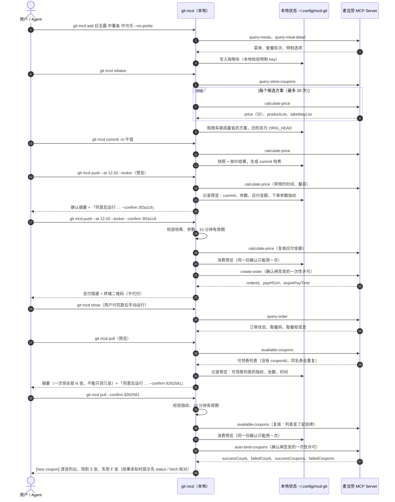

# MCP 集成说明

mcd-git 是麦当劳中国 MCP Server 的一个命令行客户端：把 MCP 的 tool 包装成 git 风格的子命令，只读操作随便用，写操作（下单、取消、领券）必须过一道由代码执行的确认闸。

## 1. 使用的 MCP Server

| 项 | 内容 |
|---|---|
| Server | 麦当劳中国 MCP Server（`serverInfo`：`mcd-mcp` 1.0.0） |
| 地址 | `https://mcp.mcd.cn`（写死在代码里，不读环境变量；别的协议或主机在发请求前就拒绝；不跟随重定向，服务端回 30x 直接报错，Token 不会被带去别处） |
| 传输 | Streamable HTTP，JSON-RPC 2.0，协议版本 `2025-06-18`；兼容 `application/json` 和 SSE 两种响应 |
| 认证 | `Authorization: Bearer <MCP Token>`；Token 读取顺序：环境变量 `MCD_MCP_TOKEN` → `~/.config/mcd-mcp/token` |
| 配置示例 | [mcp-config.example.json](mcp-config.example.json)（只含 `${MCD_MCP_TOKEN}` 占位符） |
| 实现 | `src/mcd_git/mcp_client.py`（只用标准库）、`src/mcd_git/api.py`（参数组装、返回归一化、调用计数） |

每个进程只 `initialize` 一次。服务端实测是无状态的（不返回 `Mcp-Session-Id`），客户端仍然兼容会话头。

## 2. 实际用到的 tool（14 个）

| tool | 读 / 写 | 用在哪些命令 | 用途 |
|---|---|---|---|
| `query-nearby-stores` | 读 | `init` | 收藏门店（searchType=1）、按地标搜门店（searchType=2）；得来速（beType=5）拿 beCode |
| `delivery-query-addresses` | 读 | `init --mode delivery` | 选收货地址，只保留 addressId 和打码后的提示 |
| `delivery-query-stores` | 读 | `init --mode delivery` | 按地址找能送的门店，拿外送 beCode |
| `query-meals` | 读 | `add`、`ls-remote`、`rebase`、`cherry-pick` | 当前门店、当前渠道的菜单（code 跟门店和渠道走） |
| `query-meal-detail` | 读 | `add`、`rebase`、`cherry-pick` | 套餐各轮选项、单品特制（去酸黄瓜、冰量、加浓缩） |
| `calculate-price` | 读 | `diff`、`rebase`、`commit`、`push` | 核价；`takeWayCode` 只取自它返回的 `takeWayList` |
| `query-store-coupons` | 读 | `status`、`rebase` | 本店、本渠道可用的券 |
| `order-list` | 读 | `log`、`log --stat`、`show`、`cherry-pick`、`card` | 最近 10 单（接口没有分页），合进本地提交历史，并顺手记进本机订单账本 |
| `query-order` | 读 | `show`、`revert` | 订单状态、取餐码、取餐柜、外送进度；`show` 时顺手把这一单的原价、优惠记进本机订单账本 |
| `campaign-calendar` | 读 | `fetch` | 今日和近期活动 |
| `available-coupons` | 读 | `fetch`、`pull` | 可领的券（fetch 展示、pull 预览和确认前复核） |
| `create-order` | **写** | `push`（确认之后） | 生成待支付订单，返回 `payH5Url`，终端里渲染二维码 |
| `cancel-order` | **写** | `revert`（确认之后） | 取消订单，`cancelReasonCode` 由用户选 |
| `auto-bind-coupons` | **写** | `pull`（确认之后） | 一次领取全部可领券（没有参数，不能只领其中几张） |

明确不用、并在客户端里统一拦截的写操作：`mall-create-order`、`draw-lottery`、`party-order-create`、`delivery-create-address`。它们在 `WRITE_TOOLS` 里，但不在确认闸能放行的 `GATED_WRITE_TOOLS`（`create-order`、`cancel-order`、`auto-bind-coupons`）里，所以即使带着确认闸的许可也调不出去。许可还绑定了 tool 名：push / revert 的许可不能拿去领券，pull 的许可也不能拿去下单。

## 3. 命令与 tool 的对应（每条命令的调用次数）

| 命令 | 调用的 tool | 次数 |
|---|---|---|
| `init` | query-nearby-stores，或 delivery-query-addresses + delivery-query-stores | 1～2 |
| `status` | query-store-coupons（待支付提醒读本地记录，不发请求） | 1 |
| `ls-remote` | query-meals | 1 |
| `add <餐品>…` | query-meals + 每样一次 query-meal-detail（同一命令内缓存） | 1 + N |
| `restore` / `reset` | 无，只改本地 | 0 |
| `diff` | calculate-price；用了券再算一次「不用券」 | 1～2 |
| `rebase` | query-meals + query-store-coupons + 候选套餐的 query-meal-detail + calculate-price | calculate-price ≤ 20 |
| `commit` | calculate-price | 1 |
| `push`（预览） | calculate-price | 1 |
| `push --confirm` | calculate-price（复核）+ create-order | 1 + 1 |
| `log` | order-list | 1 |
| `log --stat` | order-list（刷新本机账本，统计来自账本） | 1 |
| `show` | query-order（按哈希找历史单时再加一次 order-list） | 1～2 |
| `cherry-pick` | 本地同店的 commit：0；否则 order-list + query-meals + query-meal-detail | 0～N |
| `revert`（预览 / --confirm） | query-order；确认后再加 cancel-order | 1 / 2 |
| `fetch` | campaign-calendar + available-coupons | 2 |
| `pull`（预览 / `--dry-run`） | available-coupons | 1 |
| `pull`（终端里答 y） | available-coupons + auto-bind-coupons | 1 + 1 |
| `pull --confirm` | available-coupons（复核列表）+ auto-bind-coupons | 1 + 1 |
| `card` | order-list（刷新本机账本，格子来自账本） | 1 |

每条命令的 MCP 调用总数上限 60，`calculate-price` 上限 20；超过就停下并如实提示。

## 4. 调用流程

## 5. 返回解析要点（来自实测）

- **信封**：优先读 `structuredContent`；缺失时才从 Markdown 文本里找第一个 `{"success": …}` JSON（三种文本布局都兼容）。业务失败时 `isError` 仍是 `false`，要看信封里的 `success` 和 `code`，失败时没有 `data`。报错会带上 code 和 traceId，按 git 的 `remote:` 行展示。
- **金额单位混用**：`calculate-price` 和特制价格是「分」整数，菜单和订单是「元」字符串，套餐换搭差价是 `"+ ¥2.5"` 这样的展示串。内部一律换算成「分」。
- **一单一券**：券作为一个 item 传（券的 productCode + couponId + couponCode），两张券会报 600022。券和账户自带折扣可能互斥，所以 `rebase` 和 `diff` 都分别真实算价，不在本地叠加。
- **takeWayCode 因店而异**：只取自本次 `calculate-price` 的 `takeWayList`；`--locker` 只在出现 `locker-*` 时可用，否则明确报错。
- **订单状态**：`orderStatus` 实测是中文（如「订单已完成」），另有数字串 `status`；按中文关键词 → schema 数字码 → 原样显示的顺序兼容。
- **商品 code 跟门店和渠道走**：`cherry-pick` 换了门店或渠道就按新菜单重新解析（code → 规范化名称 → 套餐子项逐轮对齐），对不上的报 `CONFLICT`。
- **特制**：服务端算价不校验特制 key，所以只接受 `query-meal-detail` 里真实存在的选项；带 `unselectedKey` 的组整组传。

## 6. 写操作边界（确认闸）

实现见 `src/mcd_git/gate.py` 和 `src/mcd_git/commands/push.py`、`revert.py`、`pull.py`。

1. 写 tool 只能拿着 `Approval` 调用；`Approval` 只由确认闸签发，绑定 tool 名和参数指纹，用一次就作废。`McdApi` 发请求前还会核对许可的 tool 和要调用的 tool 一致；客户端只放行 `GATED_WRITE_TOOLS` 里的三个写操作。
2. 交互终端：先出确认摘要，再问 `y/N`，默认 N。
3. 非交互（Agent、管道、`--json`）：只出摘要和下一步命令，把预览记进本地状态，不下单。
4. `--confirm <commit 哈希>`：必须有 10 分钟内、同一 commit、同样参数的预览；重新算价后应付金额不变、下单参数指纹不变，才会调用 `create-order`。任何一项不符都拒绝，并要求重新预览。
5. `--dry-run` 只出摘要；`--force` 一律拒绝；HEAD 已经 push 过、购物车也空着，就输出 `Everything up-to-date`；购物车里还有没 commit 的餐品（比如刚 `cherry-pick` 回来），直接报「购物车还没 commit」，不会返回 up-to-date。HEAD 还没 push、购物车里又有了改动（比如预览之后又 `add`）时，push 只会按 HEAD 下单，所以预览和 `--confirm` 都直接报错、不下单，提示 `git mcd commit --amend` 并进这一单或 `git mcd reset` 放弃改动；`--json` 里 `error.detail.code` 是 `uncommitted_changes`。HEAD 是另一家店或另一种取餐方式的单时（比如 commit 之后 `init` 换了店），`commit --amend` 会拒绝，所以不提示 amend（`error.detail.amend` 为 null），只给 `git mcd reset` 放弃购物车和 `git mcd reset --soft HEAD~1` 撤回 HEAD（`error.detail.withdraw`）。HEAD 还没 push 时 `cherry-pick HEAD` 直接拒绝（`empty_cherry_pick`），不会把同一单再放一份进购物车、amend 之后翻倍。
6. `create-order` 只有在服务端明确拒绝时才提示「什么都没下单」：信封里的业务错误码、HTTP 4xx，或 JSON-RPC 层没受理这次请求（-32700 / -32600 / -32601 / -32602）。网络超时、30x、5xx、其余 JSON-RPC 错误（如 -32603 Internal error、-32000～-32099）、响应被截断、返回看不懂或没有订单号、Ctrl+C 中断，一律按结果未知处理：不自动重试，提示先 `git mcd log` 核对。
7. 只生成待支付订单，只返回支付链接，**不代付**；付款后由用户自己运行 `git mcd show` 查取餐码，不轮询。
8. `revert`（cancel-order）同样：必须选取消原因（1 改主意了、2 重复下单、3 点错了、4 地址电话填错、5 送达时间选错、-1 其它），预览 → 同意 → `--confirm <订单号>`。
9. `pull`（auto-bind-coupons）同样：预览 → 同意 → `--confirm <指纹>`。这个 tool 没有参数，一次领取全部可领券，不能只领其中几张，摘要里逐张列出并写明这一点。指纹按可领券列表（名称、状态、标签的多重集合，稳定排序）算出；`--confirm` 必须对得上 10 分钟内的预览，确认时重新拉一次 `available-coupons`，指纹变了就拒绝并要求重新预览，列表空了就输出 `Already up to date.`；预览在发请求前被消费，只能用一次。交互终端回答 y 之后立即领取（和 push 的交互路径一样不再重拉列表），领的是发请求那一刻的全部可领券。只有服务端明确拒绝（判断同第 6 条）才提示「什么都没领」，其余一律按结果未知处理：不自动重试，提示先 `git mcd status` 或 `git mcd fetch` 核对。`--force` 一律拒绝，`--dry-run` 只出预览；返回里的 couponId、券码不展示，也不进 `--json` 输出。

自动化测试全部离线：push / revert / pull 的真实链路只用 mock 客户端测试（`tests/test_push_gate.py`、`tests/test_pull_gate.py`），从不对真实账户调用写操作。

## 7. 调用频率与合规

- 每一次调用都由用户的命令触发；没有后台进程、定时任务或轮询。
- 领券只在用户运行 `git mcd pull` 并确认之后发生，只领用户自己账户的券；不做定时、循环或批量领券。
- `calculate-price` 每条命令最多 20 次并缓存相同参数；遇到 HTTP 429 只对只读 tool 做两次指数退避（1 秒、2 秒），写操作不重试。
- Token 只放在本机、只出现在请求头里，不进日志、不进仓库、不上传任何第三方平台，也不需要放进 CI。
- 个人信息：收货地址只保留 addressId 和打码提示；外送订单里的地址、手机号、骑手信息在解析时就丢弃，不展示、不进 `--json` 输出。
- 本机订单账本 `~/.config/mcd-git/ledger.json`（目录 700、文件 600）只存下单时间、状态、餐品名和份数、原价 / 优惠 / 实付、取餐方式和 push 它的本地 commit；订单号只存哈希，不存门店、地址、手机号、取餐码、支付链接。`card` 生成的 SVG 只写在本机，卡片上没有门店、订单号、具体时刻和总消费，mcd-git 不会上传它，也不提供定时生成。

## 8. 业务价值

- **对用户：省钱、省事、安心。** `rebase` 在不多点东西的前提下自动凑套餐、挑最省的券，每个方案都以实时算价为准；`cherry-pick HEAD` 一键再来一单，换了门店也能对齐；预约、取餐柜、不要餐具、备注一条 `push` 说清楚；下单前一定有确认摘要，价格变了会拦下来。
- **对 Agent 场景：给模型一套带护栏的工具。** `--json` 输出稳定好解析，写操作的确认由代码强制，比把 MCP 写操作直接交给模型更可控；SKILL.md 让 WorkBuddy / Claude Code / Kiro 开箱就能用。
- **对 MCP 能力的覆盖**：除了点餐和算价的主链路，还用上了取餐柜（`locker-*`）、预约（`reservationDate`）、特制（modification）、套餐换搭（roundList）、餐具（`needTableware`）、外送备注、取消订单和订单详情，把这些不太常用的参数做成了顺手的命令行选项。

## 9. 已知限制

- `order-list` 只有最近 10 单，`log` 拿不到更早的历史；`card` 的格子靠本机账本慢慢补全，刚开始用会比较空。`order-list` 也不返回原价和优惠，`card --with-savings` 和 `log --stat` 只算 push 或 show 过的单省下的钱。
- 0 元订单（全额预付券）是否返回 `payH5Url` 未实测；没有链接时会提示去麦当劳 App 的订单页查看。
- 取餐柜订单里 `lockerCode` / `lockerQrCode` 的真实形态未实测，按可选字段处理。
- 特制（`--no-pickle`、`--with 少冰`、`--with 加一份浓缩` 等）按 schema 传 `modification`，多选组里没选中的项传 `quantity: 0`。`calculate-price` 既不校验也不回显特制，真实下单实测（见 §10）的那一单又没有特制，所以特制在真实订单里是否生效**尚未实测**。下单后可以用 `git mcd show` 核对子项名称（来自 `query-order` 的 `comboItemList`）。
- `auto-bind-coupons` 只按 outputSchema 实现（`successCount`、`failedCount`、`totalCount`、`successCoupons`、`failedCoupons`），真实账户还没调用过。解析做了容错：计数缺失就用名单长度，名单缺失就只显示张数。`data` 不是对象，或者这四个计数 / 名单字段（不算 `totalCount`）一个合法值都没有（比如 `{}`、字段名和 schema 对不上），都按结果未知处理：退出码 1，提示先 `git mcd status` 或 `git mcd fetch` 核对，不重试。服务端明确回了 0 张成功、0 张失败时输出 `Already up to date.`，同样提示用 `git mcd fetch` 核对。
- 随单购（withOrder）、团餐（beType=6）暂不支持。

## 10. 真实下单实测（2026-10-10）

用作者本人的账户走了一遍真实下单和取消：到店自取，一瓶纯净水，没有付款。

- `push` 先出预览，再按返回的 `data.next` 带 `--confirm` 执行：`calculate-price` 1 次、`create-order` 1 次，生成待支付订单，`orderStatus` 返回的是中文「待支付」。
- `payH5Url` 指向麦当劳官方 H5 页面（`m.mcd.cn`），能正常打开；`expirePayTime` 是下单后 15 分钟。
- `git mcd status` 和 `git mcd show` 都会提示待支付和付款截止时间。
- `revert --reason=-1` 同样先预览、再带 `--confirm` 执行：`cancel-order` 1 次，随后 `git mcd show` 显示「订单已取消」。
