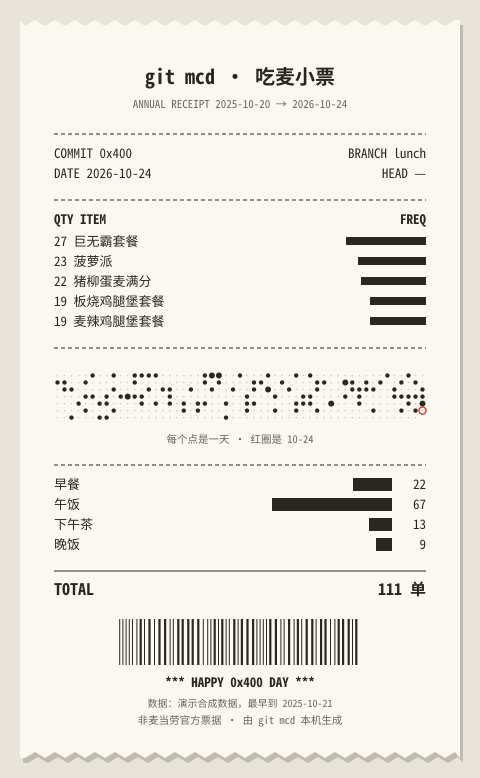
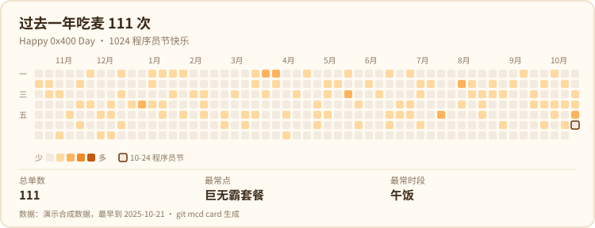
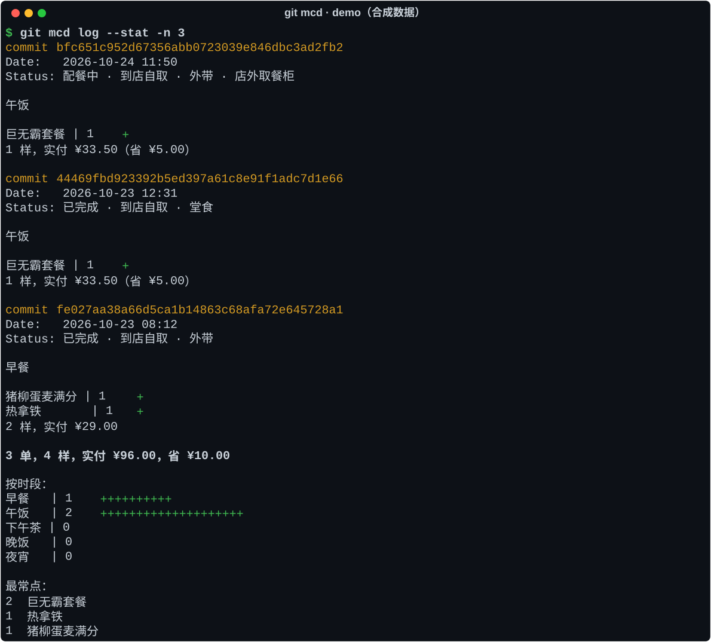
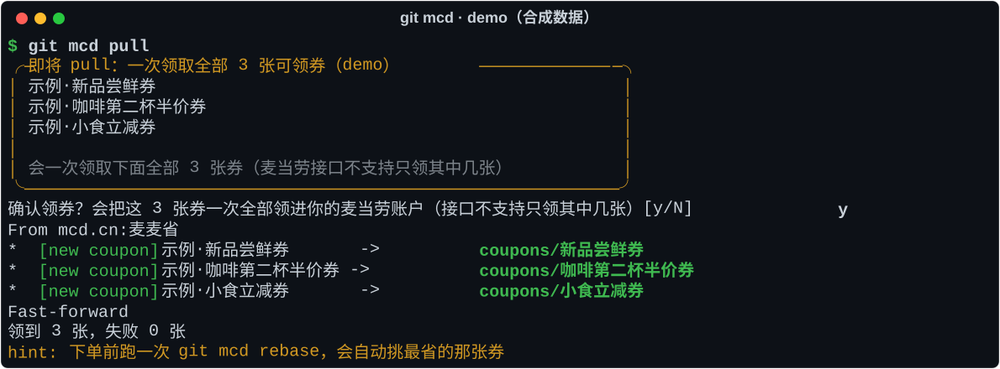
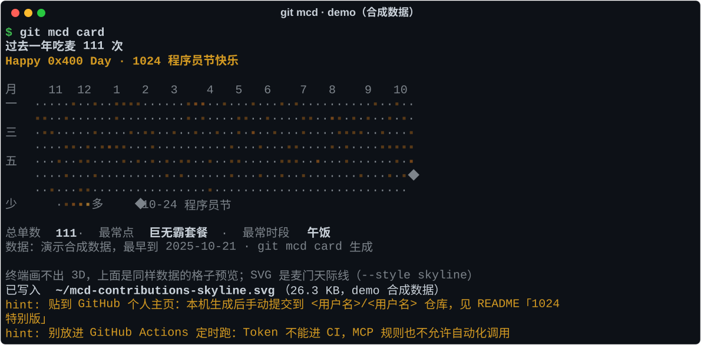
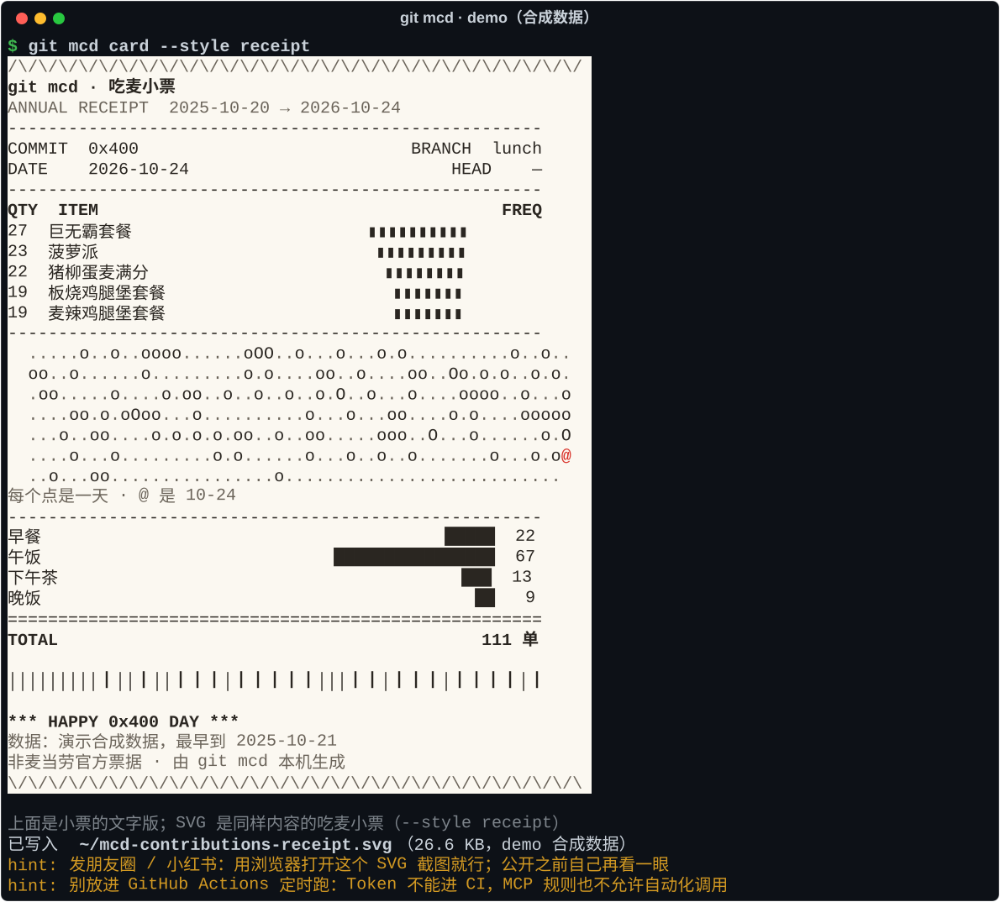

# mcd-git · 用 git 命令点麦当劳

<p>
  
  
  
  
  
</p>

`git mcd add` 放进购物车，`git mcd rebase` 自动凑套餐、挑最省的券，`git mcd push` 才真正下单，终端里直接出支付二维码。基于麦当劳中国 MCP Server（`mcp.mcd.cn`）。


> 动图和下面所有截图都是 `--demo` 合成数据：门店、价格、订单号、券都是编的，支付链接指向 `example.com`。

## 一套引擎，两个入口

- **开发者**：在终端里敲 `git mcd`。`git-mcd` 在 PATH 里，git 就会把 `git mcd …` 交给它，任何目录都能用，不碰你代码仓库的 `.git`。
- **普通用户**：把 [SKILL.md](SKILL.md) 装进 WorkBuddy / Claude Code / Kiro，用大白话点餐，Agent 在后台跑 `git mcd --json`。

一段 Agent 对话（demo 数据）：

```text
你：   中午想吃巨无霸，不要酸黄瓜，再来中薯条和中可乐。12:20 去店外取餐柜拿，不要餐具，看看怎么最省。

Agent：（git mcd add 巨无霸 中薯条 中可乐 --no-pickle --json → git mcd rebase --json → git mcd diff --json）
       三样正好凑成巨无霸套餐，再用一张「示例·巨无霸套餐立减 5 元」：¥45.50 → ¥33.50。
       （git mcd commit -m 午饭 --json → git mcd push --at 12:20 --locker --no-tableware --json）
       门店 演示·代码港店 · 外带·店外取餐柜 · 预约 12:20 · 不要餐具
       巨无霸套餐 [巨无霸 · 中薯条 · 中可乐] 去酸黄瓜，应付 ¥33.50。要下单吗？付款需要你自己完成。

你：   确认。

Agent：（git mcd push --at 12:20 --locker --no-tableware --confirm bfc651c --json）
       下好了，请在 12:05 前打开这个链接付款：https://example.com/mcd-git-demo/pay?orderId=1024…
       付完跟我说一声，我帮你查取餐码。
```

**和普通 Skill 的区别：确认由代码强制执行。** 普通 Skill 只是一段提示词，Agent 手里有 MCP 连接器就能随时直接调 `create-order`。mcd-git 的 Skill 不需要给 Agent 配 MCP 连接器，Token 只给 mcd-git 用，Agent 手里只有 `git mcd` 这一套命令：下单必须先出确认摘要，再用 `--confirm <commit 哈希>` 执行；哈希、参数、重新算出的应付金额，任何一项和预览时对不上，代码都会拒绝。代码保证的是这三件事：一定先出预览，确认时不能换参数，价格会复核。至于 Agent 有没有先把摘要拿给你看、等你点头，代码分辨不出来，这一步靠 SKILL.md 的规则约束 Agent。

## 1024 特别版：生成你的吃麦贡献图


把吃麦记录（最多过去一年）画成一张卡片，有三种样式，用 `--style` 选：

- **麦门天际线**（`skyline`，默认）：等距 3D，最多 53 周 × 7 天，每天吃了几次就叠几层汉堡（底面包、肉饼、芝士、生菜、顶面包），超过 4 层只画 4 层、顶上标一个「+」；10-24 那格插一面「0x400」小旗。打开时汉堡按周从左到右落下叠好，只播一次、3 秒内停在完整状态，系统开了「减弱动态效果」就直接显示完成状态。默认深色夜景，浅色模式下换成奶油底。宽版，适合贴在 GitHub 个人主页。
- **年度吃麦小票**（`receipt`）：竖版热敏小票，最常点 TOP 5 当商品行，中间一块点阵热力图（红圈是 10-24），下面是时段分布、TOTAL 和一根装饰条形码。适合发朋友圈、小红书。
- **平面格子**（`grid`）：GitHub 风格的 7 行 × 53 周格子，颜色深浅表示那天吃了几单，10-24 那格单独描边。最朴素，放进文档里也不扎眼。

<p align="center"></p>

<details>
<summary>平面格子（--style grid）</summary>



</details>

真实卡片从你最早一单开始画（最少 12 周，最多 53 周），随使用越来越满：麦当劳接口只给最近 10 单，更早的要靠本机账本慢慢攒；10-24 不在画出来的这几周里时，天际线不插小旗、小票不画红圈（天际线底部那格「10-24 / Happy 0x400 Day」是 1024 特别版的固定标语，一直都在）。上面三张是 demo 一年的合成数据，所以是满的；平面格子固定画 53 周。

终端里先出预览（终端画不出 3D，天际线和格子都用格子预览；小票直接打印文字版），同时在本机写一个 SVG：自包含（不引用外部字体、图片和脚本，重复的图形用 `<defs>` + `<use>` 复用），跟着系统切换浅色 / 深色，二三十 KB。同样的数据每次生成的文件都一样。

```bash
git mcd --demo card                    # 先用合成数据看看效果（上面这张就是），写到当前目录的 mcd-contributions.svg
git mcd card                           # 用你自己的记录，默认麦门天际线，从你最早一单画起
git mcd card --style receipt           # 年度吃麦小票，默认写到 mcd-receipt.svg
git mcd card --style grid              # 平面格子
git mcd card -o ~/Desktop/mcd.svg      # 换个地方写
git mcd card --with-savings            # 卡片上多一项「用券省下 ¥X」（默认不出现任何金额）
```

`--with-savings` 的数是下限：`order-list` 不返回优惠明细，只有 push 过或 `show` 过的单才知道省了多少。天际线和小票上有单缺明细时会写「只算有优惠明细的 N 单，是下限」，终端里也会提示。

**贴到 GitHub 个人主页**（全程在本机手动完成）：

1. 建一个和用户名同名的仓库 `<用户名>/<用户名>`，GitHub 会把它的 README 显示在你的个人主页上；
2. 在本机运行 `git mcd card -o <那个仓库的目录>/mcd-contributions.svg`；
3. 在那个仓库的 README.md 里加一行 ``；
4. 自己 `git add`、`git commit`、`git push`。

**不要用 GitHub Actions 定时生成。** MCP Token 不能放进 CI（服务规则不允许把凭证托管到第三方平台），也不允许自动化调用。想更新就在本机再跑一次 `git mcd card`。

**卡片上有什么**：日期级的格子（或汉堡、点阵）、总单数、最常点（小票是 TOP 5 和次数）、最常时段，以及数据范围（比如「数据：麦当劳最近 10 单 + 本机记录，最早到 2026-10-21」）。没有门店、地址、订单号、手机号、具体下单时刻和总消费；只有加了 `--with-savings` 才显示省下的钱。公开之前自己再看一眼。

**数据从哪来**：`order-list` 只返回最近 10 单，所以刚开始用时格子会比较空。mcd-git 会把看到的订单记进本机账本，用得越久越全；取消的和没付款的单不算。

**本机订单账本**：`~/.config/mcd-git/ledger.json`（demo 用的是另一份 `~/.config/mcd-git/demo/ledger.json`），文件权限 600，只给吃麦贡献图当数据。`log`、`cherry-pick`、`card` 查 `order-list` 时顺手合并最近 10 单，`show` 顺手补上那一单的原价和优惠（同一单按订单号合并，新状态覆盖旧状态），`push` 下单成功时记一笔，并和那个本地 commit 关联起来。每单只存下单时间、状态、餐品名和份数、原价 / 优惠 / 实付、取餐方式；不存订单号原文（只存它的哈希）、门店、手机号、地址、取餐码、支付链接。删掉这个文件就清空了，不影响购物车和订单。

## git 命令 ↔ 点餐动作

| git mcd | 点餐动作 | 会改动你的账户吗 |
|---|---|---|
| `init` | 选门店和取餐方式（到店 / 得来速 / 麦乐送），相当于设置远端 | 否 |
| `status` | 当前分支（按时段：breakfast / lunch / tea / dinner）、购物车、可用券、待支付订单 | 否 |
| `ls-remote [关键词]` | 看本店菜单：不带关键词按分类分组，超过一屏用分页器；价格是真实可得价，要随单购会员卡才有的优惠价另外注明 | 否 |
| `add <餐品>` | 放进购物车；`--no-pickle` 去酸黄瓜，`--with 少冰`，`--choose 大薯条` | 否 |
| `restore --staged <餐品>` | 从购物车拿出来 | 否 |
| `reset` | 清空购物车；`reset ORIG_HEAD` 撤销 rebase；`reset --soft HEAD~1` 撤回没 push 的 commit | 否 |
| `diff` | 像 unified diff 一样逐行看差价：菜单价 vs 应付，或用券前 vs 用券后 | 否 |
| `rebase` | 单品凑成套餐（squash）、换上最省的一张券（coupon），每个方案都真实算价 | 否 |
| `commit -m <说明>` | 锁定这一单：本地快照 + 核价，哈希由内容决定 | 否 |
| `push` | **真正下单**，出支付链接和二维码；支持 `--at 12:20` 预约、`--locker` 取餐柜、`--no-tableware`、`--remark` | ✎ 会，先确认 |
| `log --graph` | 吃麦提交历史，按时段画分支图 | 否 |
| `log --stat` | 吃麦统计：每单列出餐品、实付和省下的钱，最后汇总单数、金额、时段分布和最常点；支持 `-n`、`--since`、`--until` | 否 |
| `show [HEAD]` | 订单状态、取餐码、取餐柜、外送进度（只在你运行时查一次） | 否 |
| `cherry-pick HEAD` | 再来一单：把上一单拣回购物车，换了门店也会按新菜单重新对齐 | 否 |
| `revert` | 取消订单，必须选原因 | ✎ 会，先确认 |
| `fetch` | 今日活动、可领的券（只读） | 否 |
| `pull` | 领券：先列出可领券，确认后一次领取全部（接口不支持只领几张） | ✎ 会，先确认 |
| `card` | 1024 吃麦贡献图：终端预览 + 本机 SVG，`--style skyline / receipt / grid` 选天际线、小票或格子（见上面「1024 特别版」） | 否 |

所有命令都支持 `--demo`（合成数据，不需要 Token）和 `--json`（给 Agent 和脚本用）。对照表随时看：`git mcd help`。

## 30 秒试玩，无需 Token

装了 uv 的话，一行就能跑：

```bash
uvx --from git+https://github.com/zhutoumeme/mcd-git git-mcd --demo status
```

想多玩几步，就装上它（需要 Python 3.9+）：

```bash
pip install "git+https://github.com/zhutoumeme/mcd-git"   # 或 uv tool install git+https://github.com/zhutoumeme/mcd-git

git mcd --demo status
git mcd --demo add 巨无霸 中薯条 中可乐 --no-pickle
git mcd --demo diff
git mcd --demo rebase
git mcd --demo commit -m "发版前的午饭"
git mcd --demo push --at 12:20 --locker --no-tableware   # 终端里会问 y/N
git mcd --demo log --graph
git mcd --demo log --stat                                # 吃麦统计：每单餐品、实付、省了多少，按时段汇总
git mcd --demo show
git mcd --demo cherry-pick HEAD
git mcd --demo pull                                      # 领券，终端里会问 y/N
git mcd --demo card                                      # 吃麦贡献图（麦门天际线），写到当前目录的 mcd-contributions.svg
git mcd --demo card --style receipt                      # 年度吃麦小票，终端里也会打印一张
```

装完会有两个等价的命令：`git-mcd`（git 会把 `git mcd` 分发给它）和 `mcd-git`。demo 的状态单独放在 `~/.config/mcd-git/demo/`，想从头再来就 `git mcd --demo init --pick 1`。嫌每条都敲 `--demo` 麻烦，可以先 `export MCD_GIT_DEMO=1`（首屏动图就是这么录的）。

## 命令一览

### init：选门店，相当于设置远端

不带参数列收藏门店；按地标搜要同时给城市和关键词：`git mcd init --city 南京 --keyword 新街口`（只给其中一个，麦当劳接口都不认）。门店列表按终端宽度显示全名。接口一次大约只给 5 家，`--limit 3` 只列前 3 家（只在本地截取，不会多调接口）；想看别的店就换个更具体的地标。


### status：看看现在什么情况


### add：放进购物车，顺手去掉酸黄瓜


### diff：每一分钱花在哪儿


### rebase：凑套餐 + 挑券，省下来的才是真的

`rebase` 只在购物车里的单品正好能凑满套餐（主食、小食、饮料都在）时才 squash，绝不为了便宜往购物车里多塞东西。一单只能用一张券，而且券和账户自带的折扣可能互斥，所以每个方案都会真实调一次 `calculate-price`，每条命令最多 20 次。不满意就 `git mcd reset ORIG_HEAD`。


### commit：锁定这一单


### push：确认后才下单，出支付二维码

终端里先给确认摘要再问 y/N。Agent、管道或 `--json` 等非交互环境只出摘要，用户同意后再用 `--confirm <commit 哈希>` 执行。mcd-git 只生成待支付订单，**不会替你付款**。终端够宽时二维码每个模块画成两格背景色，四周留足 4 格白边，手机更好扫；扫不出来就直接打开下面的支付链接，或到麦当劳 App 订单页付款。


### log --graph：吃麦提交历史


### log --stat：吃麦统计

像 `git log --stat` 一样，每单下面列出餐品行和一行小结（几样、实付、用券省了多少），最后像 `diff --stat` 一样汇总：几单（其中几单已取消、几单待支付）、几样、实付、省下的钱，再按早餐 / 午饭 / 下午茶 / 晚饭 / 夜宵画分布，列出最常点的前 3 名。已取消的单照常显示但不计入金额，待支付的单单独标出、也不计入。数据来自本机账本，运行时先调一次 `order-list` 刷新最近 10 单；`-n 20` 看更多，`--since 2026-10-01 --until 2026-10-31` 按日期筛（含当天）。`order-list` 不返回原价和优惠，没 push 或 show 过的单省了多少不知道，汇总里会提示有几单没算进去。不显示热量。



### show：取餐码在这里


### cherry-pick HEAD：再来一单


### pull：领券，同样先确认

像 `git pull` 一样 fetch + merge：先列出麦麦省里可领的券，你确认后调一次 `auto-bind-coupons` 把它们领进账户。这个接口没有参数，只能一次领全部、不能只挑其中几张，所以摘要里会把要领的每一张都列出来。终端里回答 y 就立即领取，领的是那一刻的全部可领券，摘要放了很久的话先回答 N 再重新运行一次。非交互环境只出摘要，用户同意后再用 `--confirm <指纹>` 执行；确认时会重新拉一次列表，和预览时不一样就拒绝。没有可领的券时输出 `Already up to date.`。领到之后，下单前跑一次 `git mcd rebase` 就会自动挑最省的那张。



### card：1024 吃麦贡献图

终端里一周一列：有颜色时一格一个小方块，管道和 `NO_COLOR` 下用 `· ░ ▒ ▓ █` 分档。终端画不出 3D，默认的麦门天际线也用这份格子预览；卡片本身写成 SVG，见上面「1024 特别版」。



`--style receipt` 在终端里直接打印一张文字小票：



### help：对照表

对照表用 `git mcd help` 看（`git mcd -h` 和不带参数的 `git mcd` 也行）。注意别在 `mcd` 后面直接跟 `--help`，git 会把它拦截成 `git help mcd` 去找 man 手册。子命令的帮助照常可用，比如 `git mcd push -h`。


## 接入真实账户（3 步）

1. **申请 Token**：在 [麦当劳 MCP 开放平台](https://open.mcd.cn/mcp) 登录控制台，激活并复制 MCP Token。
2. **放在本机**：二选一，两个都有时环境变量 `MCD_MCP_TOKEN` 优先，其次读 `~/.config/mcd-mcp/token`。Token 不会被打印、写日志或写进仓库。
   ```bash
   # 长期使用：从剪贴板写进文件（macOS 示例，Token 不会留在 shell 历史里）
   mkdir -p ~/.config/mcd-mcp && pbpaste > ~/.config/mcd-mcp/token && chmod 600 ~/.config/mcd-mcp/token
   # 临时使用：只在当前终端有效
   export MCD_MCP_TOKEN=你的Token
   ```
3. **选门店开点**：`git mcd init` 列收藏门店，或 `git mcd init --city 上海 --keyword 人民广场` 按地标搜；得来速加 `--mode drive`，麦乐送用 `--mode delivery`。之后的用法和 demo 一模一样。

[mcp-config.example.json](mcp-config.example.json) 是比赛要求的脱敏配置示例，只有 `${MCD_MCP_TOKEN}` 占位符。mcd-git 自己不需要它，想让其他 MCP 客户端直连时可以照着配。

**只有 `push`、`revert` 和 `pull` 会改动你的账户，每次都会先出确认摘要；不会自动付款；没有后台任务、定时或轮询，每一次调用都由你的命令触发。**

## 交给你的 Agent

把下面这段话原样发给 WorkBuddy / Claude Code / Kiro（Agent 需要能在本机执行命令）：

```text
请帮我安装 mcd-git 这个点麦当劳的 Skill：
1. 运行 uv tool install git+https://github.com/zhutoumeme/mcd-git（没有 uv 就用 pip install "git+https://github.com/zhutoumeme/mcd-git"），然后运行 git mcd help 确认装好了；
2. 把 https://github.com/zhutoumeme/mcd-git 仓库根目录的 SKILL.md 装进你的 Skill 目录（Claude Code 是 ~/.claude/skills/mcd-git/SKILL.md，Kiro 是 ~/.kiro/skills/mcd-git/SKILL.md，WorkBuddy 在「技能」里导入）；
3. 以后我说要点麦当劳，就按 SKILL.md 用 git mcd --json 操作。下单、取消和领券前必须把确认摘要给我看，我明确同意后才能加 --confirm。
Token 我会自己配置到 ~/.config/mcd-mcp/token，不用在对话里发给你。没有 Token 时先用 --demo 给我演示。
```

## 安全边界

- **写操作只有三个**：`create-order`（push）、`cancel-order`（revert）、`auto-bind-coupons`（pull），都要经过确认闸：预览 → 用户同意 → `--confirm`。积分兑换、抽奖、派对订单、新建地址这些写操作，代码里一律拦截，不调用；确认闸签发的许可也只对它对应的那一个 tool 有效。
- **确认闸由代码执行**：`--confirm` 必须对得上 10 分钟内的预览（同一个 commit、同样的参数）；真正下单前重新算价，应付金额和下单参数的指纹都要和预览时一致；`pull --confirm` 要对得上可领券列表的指纹，领之前重新拉一次列表，变了就拒绝；同一份确认只能用一次；`push --force`、`pull --force` 一律拒绝。
- **结果未知不重试**：网络超时、响应不完整、返回看不懂、按了 Ctrl+C，这些情况都不会自动重发 `create-order`，会提示先 `git mcd log` 核对，避免重复下单；`pull` 同样不会重发 `auto-bind-coupons`，会提示先 `git mcd status` 或 `git mcd fetch` 核对。
- **低频、手动**：每条命令由你触发；领券每次都由你手动触发，只领你自己账户的券，不做定时或循环领取；`calculate-price` 每条命令最多 20 次，带缓存；遇到 429 只对只读请求退避重试。
- **隐私**：Token 只在请求头里，只发给 `https://mcp.mcd.cn`（地址写死在代码里，不能用环境变量改）；收货地址只保留 addressId 和打码提示；状态文件在 `~/.config/mcd-git/`（目录 700、文件 600），本机订单账本 `ledger.json` 也在这里，只存贡献图要用的字段（见「1024 特别版」）；`card` 生成的 SVG 只写在你的电脑上，mcd-git 不会替你上传。

## 目标用户

- **天天开终端的开发者**：不想切到手机上凑券、比价，`git mcd status && git mcd rebase` 一气呵成。
- **想让 Agent 代点餐、但每一步都要看得见管得住的人**：Agent 只能用带确认闸的命令，下单前一定会先出确认摘要，参数或价格一变就作废；先问你这一步由 SKILL.md 约束 Agent。
- **常点固定几样的人**：`git mcd cherry-pick HEAD && git mcd commit -m 再来一单 && git mcd push` 就是再来一单；预约、取餐柜、不要餐具一条命令说清楚。

它解决两件事：自己算「单点还是套餐、用哪张券」太费劲；把下单交给 Agent 又怕它自作主张。

## FAQ

**真的会下单吗？** 只有 `push` 并且你确认之后才会。生成的是待支付订单，付款要你自己在支付页或麦当劳 App 里完成。付款窗口是下单后 15 分钟（用真实账户实测过），不想要了就 `git mcd revert` 取消。

**会读写我的代码仓库吗？** 不会。mcd-git 不碰任何 `.git` 目录，状态只放在 `~/.config/mcd-git/`。唯一会往别处写文件的是 `card`：只在你指定的位置写一个 SVG（默认当前目录的 `mcd-contributions.svg`，小票是 `mcd-receipt.svg`），写完会显示完整路径（比如 `已写入 ~/mcd-contributions.svg`），`--json` 的 `data.path` 是绝对路径。

**rebase 会不会为了省钱让我多吃？** 不会。只有购物车里的东西正好凑满一个套餐时才换，不会额外加任何餐品。

**价格准吗？** 一切以 `calculate-price` 的实时结果为准。`commit` 时核一次价，`push` 预览和确认时各核一次，价格变了会拦下来让你重新确认。

**去酸黄瓜、少冰这类特制一定生效吗？** mcd-git 只接受 `query-meal-detail` 里真实存在的选项，按 MCP 的参数格式传过去。但算价接口既不校验也不回显特制，真实订单里会不会照做还没实测过。下单后用 `git mcd show` 核对子项名称，以门店实际出餐为准。

**为什么一单只能用一张券？** 这是 MCP 的规则：两张券会返回「暂不支持多张券使用」（600022）。

**`log` 为什么最多只有 10 单？** `order-list` 没有分页参数，只返回最近 10 单。`log --stat` 和 `card` 会再加上本机账本里记下的订单，用得越久越全。

**`show` 会一直刷新订单状态吗？** 不会。只在你运行时查一次，不轮询。

**没有 Token 能用吗？** 加 `--demo` 就行，全套命令都能离线体验。

## 路线图

- **P1**：`stash` / `stash pop` 暂存购物车；`rebase -i` 手动挑方案；预约时段在本地先校验。
- **P2**：`ship --team` 发版庆功的团餐方案（下单仍走 push）；`push --at next-gap` 读本地 .ics 找会议空档。

欢迎提 Issue 和 PR，新命令请保持「只读命令零副作用、写操作必须过确认闸」这条规矩。

## 更多文档

- [MCP_INTEGRATION.md](MCP_INTEGRATION.md)：用到的 MCP tool、命令和 tool 的对应关系、调用时序图、业务价值和写操作边界
- [SKILL.md](SKILL.md)：给 Agent 的使用说明
- [CHANGELOG.md](CHANGELOG.md)：版本更新记录
- [CONTEST_DECLARATION.md](CONTEST_DECLARATION.md)：参赛声明
- 截图和动图可以复现：`python scripts/make_screenshots.py`、`vhs scripts/demo.tape`

## 声明

- 本项目是麦当劳程序员节创意开发大赛的参赛作品，由参赛者独立开发，非麦当劳官方产品。
- 项目输出仅供参考，不构成医疗、营养或其他专业建议。
- 餐品信息、价格及供应状态以麦当劳官方渠道的实时结果为准。

仓库里不使用麦当劳的 Logo、IP 形象或官方图片；终端截图和 `--demo` 夹具全部是合成数据。代码以 [MIT](LICENSE) 协议开源。
